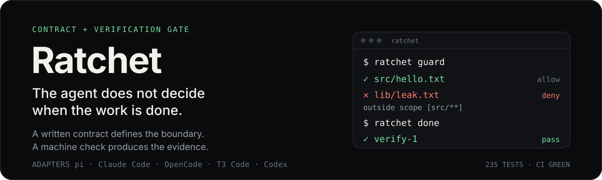
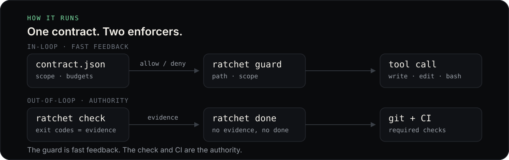

# Ratchet

<p align="center">
  
</p>

[](https://github.com/shivam2014/ratchet/actions/workflows/ci.yml)
[](LICENSE)
[](package.json)

Ratchet is a harness-neutral contract and verification gate for coding agents. It runs as a small Node CLI with no model, no API key, and no network call in the enforcement path. `ratchet ci` is the one on-demand exception: it reads an authenticated `gh` for one commit and caches the answer.

## See it work

```console
$ ratchet task start --role coder --goal "add hello file" --scope "src/**"
scope:   src/**
verify:  npm run test

$ echo '{"harness":"demo","tool":"write","input":{"path":"lib/leak.txt"}}' | ratchet guard
{"allow":false,"reason":"lib/leak.txt is outside scope [src/**]. ..."}
exit=2

$ ratchet check
PASS  verify-1  (0.2s)

$ ratchet done
DONE  <run-id>
checks: verify-1=pass
```

`npm run demo` reproduces that sequence end to end in a temporary repo, including the blocked write.

## Why

Agent instructions decay. A `SKILL.md` or `AGENTS.md` line is a suggestion the model may skip at turn 40. A type error, a failing lint rule, a test, a denied write, or a red CI check is not.

Ratchet puts the repeatable part of the workflow outside the model loop:

- **One contract per thread.** Goal, role, writable paths, budgets, verification commands. A contract is bound to a harness session, so two leads do not share scope.
- **Two enforcers.** An in-loop adapter for fast feedback; git and CI for the authority.
- **One rule table.** Every correction is paired with the mechanism that makes it impossible to repeat.

## The contract

The whole policy is a small JSON file, readable by any harness, script, or CI job:

| Field | What it means |
|---|---|
| `scope` | Writable globs. A path that does not match is denied. |
| `deny` | Always blocked, even inside scope. |
| `budgets` | Caps on distinct files and writes. Crossing a cap denies. Scratch files (`tmp-*`, `*.tmp`, `scratch/`) and paths inferred from bash do not count. |
| `verify` | Commands `ratchet check` runs. `ratchet done` refuses unless all exit 0. A non-read-only contract needs at least one that can fail. |
| `requireBrief` / `requirementsHash` | The requirements brief is required for this run, plus the hash it was started with. `check` and `done` refuse if the file disappears or changes. |
| `role` | Capability profile: coder, reviewer, writer, or a repo-defined role. |
| `goal` | Audit label. |
| `session_id` / `aliases` | The lead harness session and any worker sessions bound with `ratchet task bind`. Empty means a manual contract. |

A missing, malformed, or stale contract fails closed: writes are denied until a valid contract exists.

## How it works

<p align="center">
  
</p>

Ratchet participates at three points only:

1. **Before the loop.** `ratchet prompt` renders a deterministic Markdown brief from `contract.json`. It is string formatting, not generation.
2. **During the loop.** The adapter sends one tool call as JSON to `ratchet guard`, which returns allow or deny from path, scope, and budget rules. With `sandbox.enabled`, a bash allow also carries a fenced command; an adapter that can rewrite tool input applies it.
3. **After the loop.** `ratchet check` runs the repo's own commands and records exit codes; `ratchet done` reads that evidence and refuses to close if any check failed.

The adapter is deliberately thin. It normalises one tool call to JSON, calls `ratchet guard`, and blocks on exit 2. All policy lives in the CLI, so every harness gets the same rules.

Hard rules are evaluated on the parsed command's argv, not on raw text. A heredoc body or a commit message that mentions `git push --force` is data; `g''it push --force` still resolves to a force push, and `sh -c` is parsed recursively. Command substitution is parsed as a nested command; an unbalanced substitution fails closed.

```json
{"harness":"opencode","tool":"write","input":{"path":"src/a.ts"},"cwd":"/repo"}
```

`ratchet guard` returns `{"allow":true|false,"reason":"...","paths":[...]}` and exits 0 or 2. `--format claude` emits the `PreToolUse` JSON shape.

## Install

```bash
git clone https://github.com/shivam2014/ratchet ~/ratchet
cd ~/ratchet
npm link
ratchet init
```

`npm link` puts the `ratchet` binary on your PATH. If you would rather not use it:

```bash
ln -s "$PWD/bin/ratchet.mjs" ~/.local/bin/ratchet
```

`ratchet init` detects `package.json` scripts (`check`, `lint`, `typecheck`, `test`, `build`) and writes `.ratchet/config.json`.

## Quick start

```bash
ratchet task start --role coder --goal "add retry to the uploader" --scope "src/upload/**"
# the agent works; writes outside scope are denied
ratchet check
ratchet done
```

`ratchet done` releases the contract. A new task starts with a new contract.

### Requirements intake

The eight intake questions live in `.ratchet/requirements.md`:

```bash
ratchet brief --init                    # write the empty template (refuses to overwrite without --force)
ratchet brief --check                   # list missing sections; exits 1 until every answer is real
ratchet brief --from answers.json       # or a Markdown file with "## <heading>" sections
```

The sections are outcome and success, what must never happen, out of scope, constraints, irreversible decisions, how it will be verified, existing patterns and rules, and unknowns and prototypes. Placeholders such as TBD and TODO do not count. With no flags and a terminal, `ratchet brief` prompts for the eight answers; otherwise it stays non-interactive so an agent can fill the file.

A contract can lock the brief by hash:

```bash
ratchet brief --check
ratchet task start --role coder --goal "..." --scope "src/**" --verify "npm test" --require-brief
```

`check` and `done` refuse if the file disappears or changes. Accept an intended edit on the record:

```bash
ratchet amend --brief --reason "clarified the rollback constraint"
```

### No verify, no contract

A non-read-only contract must resolve at least one verify command, from `--verify` or from the checks in `.ratchet/config.json`. `ratchet task start` and `ratchet run` refuse an empty list. They also refuse a command that cannot fail: `true`, `:`, `echo ...`, `printf ...`, `exit 0`, or whitespace. Read-only contracts (`--read-only`, or role `reviewer`/`scout`) are exempt because they do not claim to change the tree.

### Sessions and worker threads

A contract can be bound to one harness session, making "one contract per thread" real:

```bash
ratchet task start --session <lead-id> --role coder --goal "add retry" --scope "src/upload/**"
```

Without `--session` the contract stays manual and `.ratchet/current` is the fallback, as before. With `--session`, the guard and the CLI resolve the contract by session, and more than one session-bound contract may be live in one checkout. A manual contract still keeps the old one-at-a-time rule: it refuses a second start, and it blocks a session start until it is finished or closed.

A worker session inherits the lead's boundary instead of starting a second contract:

```bash
ratchet task bind --session <child-id>                  # bind to the current contract
ratchet task bind --session <child-id> --run <lead-run> # or name the lead's run
ratchet task bind --session <child-id> --lead <lead-session-id>
```

The alias is stored in the contract (`aliases`). `ratchet check`, `ratchet done`, `ratchet task status`, `ratchet status`, and `ratchet digest --thread` accept `--session`. A worker can check the lead's contract, but only the lead session can close or amend it.

**The checkout is still shared.** Two live contracts share one git index and one working tree, so file conflicts are possible even when scopes differ. `ratchet status` lists every live contract and warns. Use one worktree per lead when two threads can touch the same files.

Tests written inside a task change the check surface, so `check` and `done` refuse until you accept the change on the record:

```bash
ratchet amend --reason "added assertions for the retry path"
ratchet amend --brief --reason "clarified the rollback constraint"
```

The amendment stores the old hash, the new hash, the changed files, and the reason in the contract. A requirements brief locked with `--require-brief` uses the same rule through `--brief`. The refusal still happens by default: an agent cannot weaken a check silently. If the task is wrong, close it without claiming success with `ratchet abandon --reason "..."`. `ratchet task start --force` replaces a live contract the caller owns (a manual contract, or the caller's own `--session`) and records the old one as abandoned. It never abandons another session's contract.

A hard rule blocked a legitimate operation? A human can approve one for the live contract, on the record:

```bash
ratchet approve --rule force-push --reason "fresh public history"
```

Approvable rules are `force-push`, `hard-reset`, and `git-clean`. The approval is stored in `contract.json`, reported by `done`, and written to `result.json`. Privilege escalation, `--no-verify`, guard-state changes, and scope denials are not approvable.

`--scope` takes one glob per flag; repeat it or use a comma-separated list (`--scope "src/**,tests/**"`). The default write budget is 120; pass `--max-writes` for a larger task.

The global view is two commands: `ratchet evidence` for one run (contract, checks, changed paths, exceptions) and `ratchet digest` for the last 30 (done/open, checks, guard wiring, scope, rules). `digest --thread <session-or-alias>` narrows the whole report to one thread's contracts. Digest v2 separates the worker-fix queue (`attention`) from `decisions` — amendments, approvals, out-of-scope runs, failing checks, and CI failures — and `exceptions`, the same items with run ids and a short reason. Every decision names the next command. `digest --root <path>` is repeatable and prints one rollup per project, even when that project has no runs yet; there is no global registry. `digest` exits 1 when a worker fix or a human decision is outstanding. Blind runs that started before the adapter was first wired are reported as history, not as a current failure.

CI is evidence on demand, not a background ingest. `ratchet ci [--run <id>]` asks an authenticated `gh` for the run's commit (or `HEAD`) and prints `pass`, `fail`, `running`, or `unknown`. `evidence --ci` attaches that status to one certificate, and `digest --ci` asks for the current or latest run only, never every row. The answer is cached per commit in `.ratchet/ci-cache.json` for two minutes, so repeated reports do not hammer the API. A missing `gh`, a signed-out account, or a network failure is `unknown` with a reason; it never turns a run red or fails the command.

### Architecture boundaries

An optional config block declares import edges the repo does not want:

```json
{
  "architecture": {
    "forbidden": [{ "from": "src/ui/**", "to": "src/core/**", "reason": "ui imports core internals" }],
    "cycles": true
  }
}
```

`ratchet arch` scans `.js`, `.mjs`, `.cjs`, `.ts`, and `.tsx` import/require/export-from specifiers, resolves relative imports, and reports an edge when the importer matches `from` and the resolved target matches `to`. `cycles: true` reports import cycles among those files. When `architecture` exists, `ratchet check` runs this after the verify commands and a violation fails the check. This is a boundary check, not a design judge: it sees only edges the config names and cycles, not layering quality, naming, or intent.

`ratchet done` also audits the working tree with git. A changed path outside `scope` refuses the close, even when the write came from a shell command the classifier never saw. Temp paths (`/tmp`, `$TMPDIR`, `/var/folders`) are allowed; symlinks are resolved first. Interpreter payloads are not. Comma-separated scopes are accepted: `--scope "src/**,tests/**"`. `ratchet abandon --run <id>` closes a stranded run that no longer owns `current`; `ratchet abandon --session <id>` closes one session's contract.

The git pre-commit hook runs `ratchet hook pre-commit`. It reads the staged paths, refuses any path outside the live contract's scope or any runtime state (`.ratchet/current`, `.ratchet/runs/**`, `install.json`, `last-check.json`, `events.jsonl`), and only then runs the contract's verify commands. With no live contract it falls back to the config's checks and warns that scope was not checked.

For a deploy-style contract, start with `--require-clean`; then `check` and `done` refuse while tracked files are modified, so the certificate covers a commit rather than a dirty working tree. Build the artifact from a clean checkout (`git archive HEAD` or a dedicated worktree), never from the live build directory.

## Write fence (optional)

A hook is policy. For a kernel boundary around bash writes, add this to `.ratchet/config.json`:

```json
{ "sandbox": { "enabled": true, "required": false } }
```

Under a live contract, a bash call then gets a profile that allows reads everywhere and writes only under the static roots of the contract's `scope`, the repo's git directory, temp directories, and common caches. A read-only contract keeps its scope closed, and guard state under `.ratchet` (active pointer, config, kill switch, run contracts and evidence) stays denied even when `scope` is `**`. A write anywhere else fails with `EPERM` inside the kernel, even when the shell classifier missed it. `required: true` refuses bash when the fence cannot be applied.

The backend is `sandbox-exec` (seatbelt) on macOS and `bubblewrap` when `bwrap` is installed on Linux. `ratchet doctor` reports the backend, and `ratchet status` prints it. Run one command under the live profile by hand:

```bash
ratchet sandbox -- npm test
```

The OpenCode adapters apply the rewrite in `execute.before`; they are the only adapters that can, because their runtime executes the tool with the input the hook returns. Other harnesses receive the profile as metadata, not enforcement, and `required: true` denies there instead of pretending.

What the fence does not cover: write and edit tool calls (those are path-checked, not sandboxed), reads, network, and MCP or subagent calls that bypass the hook. It reopens the whole static root of each scope glob, not each matching file, and keeps `.git`, temp, and caches writable. A bare control command (`ratchet check`, `done`, `amend`, `abandon`, `sandbox`, or one `cd <dir> && ratchet ...`) runs outside the fence so it can write its own evidence; a compound command that includes it is fenced.

## Harnesses

```bash
ratchet install --harness pi,claude,opencode,t3,codex --project --yes
ratchet status
```

| Harness | What `install` writes | In-loop strength |
|---|---|---|
| pi | `.pi/extensions/ratchet.ts`, `.pi/skills/ratchet-mode` | strong: `before_agent_start`, `tool_call`, `tool_result`, `agent_end` hooks |
| Claude Code | `.claude/settings.json` PreToolUse hook, `.claude/skills/ratchet-mode` | strong: `PreToolUse` |
| OpenCode | `.opencode/plugins/ratchet.js` (v2 API; v1 fallback), `.agents/skills/ratchet-mode` | partial: built-in tools only; subagents and MCP may bypass. Its hook can rewrite a bash command, so the optional write fence is real there |
| T3 Code | OpenCode provider plugin: tool guard and post-write checks; git/CI stop | partial: no T3-native prompt/stop yet; the plugin resolves the repo from each call because T3 roots one OpenCode instance at the app workspace. The OpenCode rewrite applies |
| Codex | `.codex/hooks.json` PreToolUse hook, `.agents/skills/ratchet-mode` | strong for `Bash`, `apply_patch`, and MCP; hosted tools are not covered; requires hook trust |
| Cursor | not auto-installed yet; same `PreToolUse` shape as Claude | strong, verify current hook config |

Global paths are `~/.pi/agent/extensions`, `~/.claude/settings.json`, `~/.config/opencode/plugins`, `~/.codex/hooks.json`, and `~/.agents/skills`. `ratchet status` reports adapters found on disk even when this repo has no install manifest, and labels them `(detected)`.

In a repo with `.ratchet/config.json`, a write with no live contract is denied, not waved through; read-only commands (`git status`, `grep`) and `ratchet task start` remain allowed so the gate can be armed. Interpreter payloads — `python3 - <<EOF`, `node <<EOF`, `bun -e`, `sh -s`, `node -e`, `perl -e` — are denied even when the body names an in-scope path, because the guard cannot see the rest of it; put the code in a file and run that file. If `done` prints "the guard observed 0 writes" while files changed, the adapter is not wired: the check surface was enforced, scope was not.

`--project` is the default. Use `--user` for global installs. Omit `--harness` in a terminal and Ratchet prompts with the harnesses it detected. `--dry-run` prints the plan without writing. `ratchet uninstall --harness ...` reverses only what the manifest says it installed.

## Commands

| Command | Does |
|---|---|
| `ratchet init` | Detect checks, write `.ratchet/config.json` and `rules.tsv` |
| `ratchet brief` | Requirements intake: `--init` writes the template, `--check` validates it, `--from <file>` renders JSON or Markdown answers; no flags prompts only on a terminal |
| `ratchet install` | Install adapters and skills for one or more harnesses |
| `ratchet uninstall` | Remove only the files Ratchet recorded |
| `ratchet status` | Show the contract (optionally `--session`), its age, every live contract in the checkout, stranded runs, installed harnesses, and enabled/disabled state |
| `ratchet disable` / `enable` | Kill switch for the guard, with a recorded reason |
| `ratchet task start` | Write a contract and make it current; `--session <id>` binds it to a thread; `--require-brief` locks a valid `.ratchet/requirements.md`; `--pstack` gates source behind the plan and sketch artifacts; `--bend` gates Bend code behind `LAWS.bend`; `--force` replaces a live contract the caller owns and marks it abandoned |
| `ratchet task status` | Show scope, budgets, check state, and session (`--session <id>` resolves the thread's contract) |
| `ratchet task bind` | Attach a worker `--session` to the lead's contract (`--run <id>` or `--lead <session-id>`); the worker inherits the boundary |
| `ratchet prompt` | Render the contract brief to inject into a system prompt (`--session <id>`) |
| `ratchet guard` | Enforce one normalised tool event from stdin |
| `ratchet check` | Run the contract's verification commands, then the configured architecture boundary; save evidence (`--session <id>`) |
| `ratchet hook pre-commit` | Refuse staged paths outside scope or runtime state, then run the contract's verify commands |
| `ratchet report` | Show the allow/deny trail for a run; `--session <id>`; `--json` for machine output |
| `ratchet evidence` | Per-run certificate: checks, changed paths, out-of-scope changes, amendments, approvals, rules; `--run <id>`, `--session <id>`, `--ci`, `--json` |
| `ratchet digest` | Global view across recent runs: done/open, checks, guard wiring, scope, worker fixes, decisions, exceptions; `--thread <session-or-alias>` scopes it; `--root <path>` is repeatable; `--ci` adds the current run's cached CI status; exits 1 when a fix or decision is outstanding |
| `ratchet ci` | On-demand CI status for a run's commit (or `HEAD`) through an authenticated `gh`; cached per commit; `unknown` is not fatal |
| `ratchet arch` | Check declared import boundaries and cycles; not a design review |
| `ratchet done` | Refuse without passing evidence; write `result.json`; `--session <id>` closes that thread's contract even when `current` names another |
| `ratchet amend` | Re-baseline the locked check surface (`--brief` for the requirements brief) for the lead's contract; `--session <id>`; `--reason` is required and recorded |
| `ratchet abandon` | Close the live contract, a session's contract (`--session <id>`), or a stranded one (`--run <id>`); `--reason` is required and recorded |
| `ratchet approve` | Allow one operational hard rule (`force-push`, `hard-reset`, `git-clean`) for the lead's contract; `--session <id>`; `--reason` is required and recorded |
| `ratchet audit` | Validate every rule has a machine enforcer and a proof |
| `ratchet doctor` | Check the install; `--harness codex,claude` verifies hooks, trust, and no-op behaviour |
| `ratchet sync` | Write the managed `AGENTS.md` block; `--install` adds the OpenCode and git hooks |

## Evidence

- **342 deterministic unit and CLI tests**, no network, all passing. `npm test`
- **32 CLI stress cases**, each in its own process. `npm run test:stress`
- **Real sessions** in Codex 0.163, Claude Code 2.1.258, pi 1.3.0, OpenCode 2.0.32, and T3 Code Nightly. The per-harness scripts drive real model sessions and need network plus a provider key; the unit and CLI suite does not.
- **13 rules** in `rules.tsv`, each with a machine enforcer and a proof. `ratchet audit`
- **CI** runs the suite, the stress matrix, and the rule audit on every push. Make it a required check in branch protection; that is the layer the model cannot talk around.
- **Bugs the tests caught**, recorded in [`docs/test-matrix.md`](docs/test-matrix.md): a `git -C` path escape, an `rm -f` operand skip, a Codex patch heredoc misclassified as a read, and others.

## Design principles

- **No model backend.** The CLI does not generate replies and does not treat the model's prose as evidence.
- **Fail closed.** Missing or malformed contracts block writes, and contracts are resolved per session so a sibling delegation cannot inherit another's scope. A worker only joins a lead through an explicit `ratchet task bind`.
- **Scope is audited, not inferred.** The guard reads explicit write paths and shell hints; `done` compares the working tree with git. A write the classifier missed still refuses the close. This is what keeps the gate stable as shells, interpreters, and tools change.
- **Evidence over prose.** The model's "done" message is not proof. The exit code of the repo's own checks is.
- **CI is evidence on demand.** The CLI does not poll or ingest workflows. When asked, it reads one commit's status through `gh`, caches it briefly, and reports `unknown` rather than guessing.
- **Boundaries are declared, not inferred.** `architecture.forbidden` and `architecture.cycles` make a narrow, deterministic check. It catches the edges the repo names; it does not claim to judge design.
- **Policy is not a sandbox by default.** A hook can be bypassed by an unhooked tool, a subagent, an MCP call, or `--no-verify`. The optional write fence (`sandbox.enabled`) makes bash a kernel boundary when the adapter can rewrite the command; it is off by default and does not cover write tools, reads, network, MCP, or subagents. The authority is still git and CI: a pre-commit hook for local feedback, required checks and branch protection for the real boundary.
- **One rule table.** `ratchet audit` fails when a rule claims a machine layer but names no enforcer or no proof. A check that has never failed on a real past mistake is a guess.

## State

```text
.ratchet/
  config.json
  requirements.md            requirements intake; hash-locked by task start --require-brief
  rules.tsv                  rule -> layer -> enforcer -> proof
  install.json               adapters installed from this repo
  current                    last started run id; CLI fallback, not ownership
  events.jsonl               decisions made with no live contract
  ci-cache.json              on-demand gh status per commit, short TTL, gitignored
  runs/<id>/
    contract.json
    events.jsonl             every allow/deny, append-only
    checks.json
    result.json
```

Contracts and events are plain JSON so any harness, script, or CI job can read them. Nothing is stored in a model's context.

## Status

v0.2.0. Implemented: explicit contracts, session-bound contracts and worker aliases, requirements intake and brief locking, the no-verify/no-op refusal, `guard`, `check`, `done`, `audit`, `amend`, `abandon`, `approve`, the stop gate, opt-in prompt routing, installers for five harnesses, a git pre-commit hook, and CI. The default path is still an explicit `ratchet task start`.

Routing is opt-in: set `auto.enabled` in `.ratchet/config.json`, and `ratchet hook` creates a contract from the prompt at submit time. It reads the prompt locally, makes no model call, and stores a hash rather than the raw text by default. See [`docs/vision.md`](docs/vision.md).

## What this is not

- **Not a replacement for pstack.** pstack is a library of engineering playbooks. Ratchet is the enforcement kernel those playbooks can call.
- **Not a sandbox by default.** A hook is policy, not a boundary. The optional write fence (`sandbox.enabled` in `.ratchet/config.json`) is a real kernel boundary for bash when it is enabled and the harness can rewrite the command; it is off by default and does not cover write/edit tools, MCP or subagent calls, reads, or the network. For the full boundary, run the agent in a container or a read-only checkout and let CI be the authority.
- **Not a planner.** The contract is small on purpose.

## Docs

- [`docs/vision.md`](docs/vision.md): prompt to route to contract to guard to stop gate to CI.
- [`docs/design.md`](docs/design.md): the enforcement ladder, the pi orchestrator analysis, and the harness matrix.
- [`docs/routing.md`](docs/routing.md): routing research, the cascade design, and the evaluation plan.
- [`docs/universal-integration.md`](docs/universal-integration.md): the normalised lifecycle protocol and the adapter ladder.
- [`docs/hooks.md`](docs/hooks.md): the adapter contract and its limits.
- [`docs/flow.html`](docs/flow.html): the full run, step by step, with the contract fields and the CI layer.
- [`docs/test-matrix.md`](docs/test-matrix.md): every feature, how it is tested, and the bugs the tests caught.
- [`docs/pi-test.md`](docs/pi-test.md), [`docs/claude-test.md`](docs/claude-test.md), [`docs/opencode-test.md`](docs/opencode-test.md), [`docs/codex-test.md`](docs/codex-test.md): per-harness records.
- [`docs/t3.md`](docs/t3.md): the T3 Code provider-level integration and its limits.
- [`docs/pstack.md`](docs/pstack.md), [`docs/bend.md`](docs/bend.md): optional gates for pstack skills and Bend proofs.

## License

MIT. See [`LICENSE`](LICENSE).
